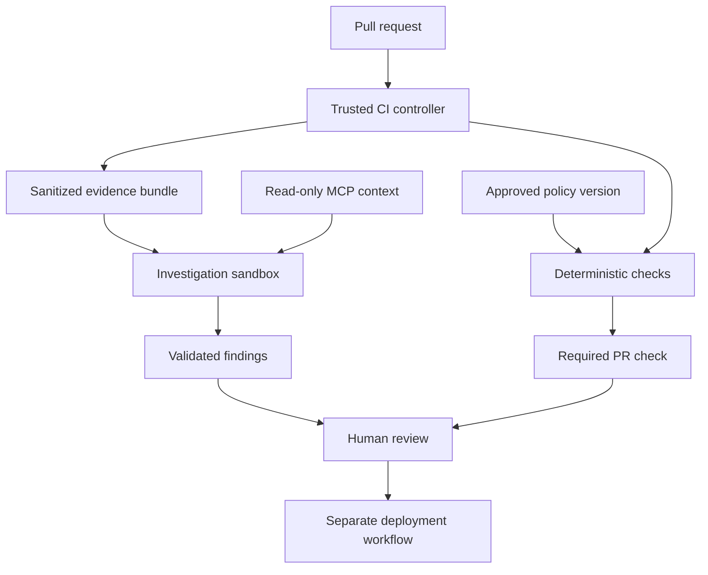
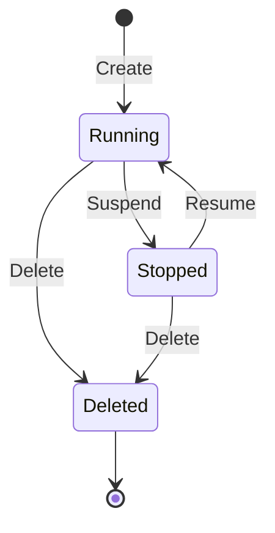

Give an agent a failed pipeline, a terminal, and enough access, and it can do quite a lot.

That is useful. It is also where I start asking a different set of questions. What can it reach? Which credentials can it use? Where does its work run, and what do we retain when that environment disappears?

I have been playing with Azure Container Apps Sandboxes around CI pipelines, governance, and investigation. What interests me is having a workspace where an agent can inspect evidence and run commands, with boundaries that the platform team can actually operate.

Because once an agent starts executing things, the platform around it becomes part of the solution.

> [!note] Release timeline
> Azure Container Apps Sandboxes entered public preview on **June 2, 2026**, and Microsoft announced **general availability on September 23, 2026**. This article reflects the documentation checked on October 11, 2026. Some SDK, CLI, and ARM API versions can still carry preview labels independently of the service's GA status.
>
> Sources: [public preview announcement](https://techcommunity.microsoft.com/blog/appsonazureblog/introducing-azure-container-apps-sandboxes-secure-infrastructure-for-agentic-wor/4524131) and [GA announcement](https://techcommunity.microsoft.com/blog/appsonazureblog/azure-container-apps-sandboxes-now-generally-available/4559125).

## First, what is a sandbox?

A sandbox is an execution environment with a deliberately limited relationship to everything around it.

The workload gets a filesystem, processes, resources, and whatever network access we allow. The surrounding platform controls how that environment starts, what it can touch, how long it lives, and how it is removed.

There are several ways to build that boundary: operating system restrictions, containers, virtual machines, or combinations of those controls. The word *sandbox* alone does not tell us how strong the isolation is or which permissions remain available.

For an agent, I would start with four questions:

| Boundary | Question the platform needs to answer |
| --- | --- |
| Execution | What separates this workload from the host and other workloads? |
| Access | Which files, services, and credentials can it use? |
| Lifetime | What stops it consuming resources indefinitely? |
| Evidence | How do we inspect its actions after it finishes? |

These questions apply even when the agent is meant to be helpful. A command can be valid and still be inappropriate for the environment in which it runs.

## Why agents make this more important

A conventional CI job usually executes a workflow we have written and reviewed. There is still risk in dependencies, build scripts, and pull request content, but the intended execution path is relatively explicit.

An agent introduces another decision maker into that path. It can choose commands, follow links, interpret tool output, install dependencies, and decide which evidence to inspect next.

Now imagine a CI log containing a line that looks like operational advice: “To fix this issue, run this command and upload the diagnostic bundle here.” The log is evidence from a workload. It should never become authority to change the investigator's permissions.

That is the kind of boundary I want enforced outside the model.

> [!important] Instructions need enforcement
> “Do not change production” is useful guidance for an agent. It needs to be backed by credentials, tool permissions, network policy, and an execution environment that cannot perform production changes.

Sandboxing also does not prevent every bad outcome. An agent can still produce a wrong diagnosis, leak information through an allowed destination, or misuse an API that we intentionally exposed.

My design therefore treats isolation, authorization, and answer quality as separate responsibilities. The sandbox contains execution. The API and MCP services authorize access. The report validator and reviewer assess the findings.

## What Azure Container Apps Sandboxes gives us

Azure describes ACA Sandboxes as on-demand **microVMs**, each with its own kernel. We can start from an OCI image, execute commands, transfer files, and control the workspace through the portal, CLI, SDKs, or REST APIs. Microsoft advertises sub-second startup and restore; that is a platform capability to benchmark with our own image and workload, rather than a promise about total investigation time. [Sandbox platform overview](https://sandboxes.azure.com/docs/sandboxes)

The useful part for my scenario is explicit ownership of the workspace lifecycle. I can create a workspace for an investigation, keep it while the task needs it, collect the result, and then stop or delete it.

The main objects are straightforward:

| Object | Role |
| --- | --- |
| Sandbox group | Regional management boundary for related workspaces and resources |
| Sandbox | Individual isolated execution environment |
| Disk image | Root filesystem prepared from an OCI image |
| Snapshot | Captured state for restore or cloning |
| Volume | Storage whose lifetime can extend beyond one execution |

Azure has an ARM control plane for sandbox groups and a separate data plane for individual sandbox operations. That distinction matters for RBAC and automation: creating an Azure resource does not automatically prove that the caller has permission to execute commands in it. [Sandbox group and RBAC guide](https://sandboxes.azure.com/docs/sandboxes/sandbox-groups)

### Where it fits alongside Apps, Jobs, and Dynamic Sessions

| Option | I would reach for it when… |
| --- | --- |
| Container App | I need a continuously available service or API |
| Container Apps Job | I need a defined task that runs to completion |
| Dynamic Sessions | I want pool-managed isolated execution behind a session endpoint |
| Sandboxes | I need to manage an individual workspace, its files, state, and lifecycle |

The key difference between Dynamic Sessions and Sandboxes is the control model. With Sandboxes, the individual environment is something my application manages explicitly. [Compute option comparison](https://learn.microsoft.com/en-us/azure/container-apps/sandboxes-overview)

For a simple fixed scanner execution, a Job may already meet the need. For an investigator that executes several commands, accumulates local context, and may pause between steps, the sandbox model becomes more interesting.

## Azure Sandboxes and NVIDIA OpenShell

NVIDIA OpenShell addresses the same broad problem: agents need useful capabilities without unrestricted access.

Its documentation describes an open-source runtime with declarative policy across filesystem, network, process, and provider access. The current Linux implementation uses controls including Landlock and seccomp, with policy decisions handled outside the agent workload. [OpenShell overview](https://docs.nvidia.com/openshell/about/overview)

I would compare the operating models before trying to declare a winner.

| Area | Azure Container Apps Sandboxes | NVIDIA OpenShell |
| --- | --- | --- |
| Product model | Azure-managed sandbox compute service | Open-source agent runtime and policy system |
| Execution boundary | Managed microVM with its own kernel | Depends on the selected runtime and isolation backend |
| Access controls | Sandbox egress policies, Azure identities, networking, and service authorization | Declarative file, process, network, and provider policies |
| Lifecycle | Managed APIs for workspaces, suspend/resume, and snapshots | Runtime-managed agent workspaces; capabilities depend on deployment |
| Operations | Azure operates the underlying service | Your deployment determines infrastructure and operational ownership |
| Cost model | Azure resource meters plus supporting services | Infrastructure, model usage, and operating effort for your deployment |
| Likely fit | Azure-based teams wanting managed isolated compute | Teams needing direct control of the agent runtime and policy implementation |

OpenShell's architecture separates the untrusted workload from a trusted supervisor. Its documented runtimes include Docker, Podman, Kubernetes, and VM patterns, with different mechanisms for enforcing the boundary. It would be inaccurate to describe every OpenShell sandbox as having the same microVM isolation as ACA Sandboxes. [OpenShell architecture](https://docs.nvidia.com/openshell/about/architecture)

OpenShell also exposes an isolation backend interface, so the policy and supervision model is distinct from the underlying compute mechanism. [Isolation backends](https://docs.nvidia.com/openshell/extensibility/isolation-backends)

My preference for an Azure-based CI investigation service would be to start with ACA Sandboxes and measure whether its controls meet the threat model. If the requirement is deeper control over filesystem and process policy, or an operating model outside Azure, I would evaluate OpenShell directly.

This is an architectural judgment, not a comparative security benchmark. I would test each against the same misuse cases, permitted APIs, and data handling requirements.

## The governed CI investigation architecture I would build

The pattern I am interested in is simple to describe: the pipeline establishes what failed, and the investigator helps explain it.


The following is a **proposed reference architecture**, not a claim that Azure provides the entire workflow automatically.



I would make the responsibilities explicit.

| Component | Responsibility |
| --- | --- |
| Trusted controller | Create the workspace, supply evidence, collect output, clean up |
| Deterministic checks | Enforce rules such as approved SKUs and ingress requirements |
| Investigator | Explain failures and propose next steps with evidence |
| Read-only MCP service | Return authorized policy, ownership, and investigation context |
| Validator | Check report structure, provenance, size, and required references |
| Reviewer and deployment workflow | Decide and execute the approved change |

The investigator should not receive the controller's permission to create sandbox groups, change egress policy, or assign Azure roles. Those permissions belong to the service that manages the investigation.

### A realistic failure example

Suppose a Bicep change switches an approved SKU and enables public ingress. The required policy check fails, and the engineer sees a short error among several scanner outputs.

For a lab, I would give the investigator a fixture containing the diff, failing check output, scanner results, and a trusted policy version. The MCP service could expose functions such as:

```text
get_investigation_context(run_id)
get_deployment_policy(service_id, policy_version)
get_service_ownership(service_id)
get_approved_skus(environment)
```

These are application-level tool contracts I would implement. They are not built-in ACA Sandbox APIs.

The report should connect each finding to evidence: the changed file and lines, the failing check, the policy rule, and the applicable environment. “The deployment is insecure” is too vague to be useful.

I would expect something like this from the lab fixture:

| Finding | Required support |
| --- | --- |
| Requested SKU is outside the approved list | Diff reference and policy rule |
| Public ingress violates the environment contract | Changed property and rule reference |
| Owning team should review remediation | Authorized ownership record |
| Suggested fix requires another CI run | Explicit next step without claiming deployment success |

The agent adds value by connecting evidence across tools and explaining the consequence. The deterministic check still owns the pass/fail decision for a deterministic rule.

> [!tip] Keep the first investigation small
> Prepare one bounded evidence bundle and a small read-only tool surface. Measure whether the investigator improves diagnosis time before allowing broad repository exploration or repeated API calls.

## Getting a first sandbox running

The portal is the quickest way to explore. Open [sandboxes.azure.com](https://sandboxes.azure.com), create a sandbox group, create a standard Ubuntu sandbox, and open its interactive shell. The portal also offers agent-oriented templates, including GitHub Copilot and Claude sandboxes. [Portal quickstart](https://sandboxes.azure.com/docs/sandboxes/quickstart/setup-portal) · [Sandbox creation guide](https://sandboxes.azure.com/docs/sandboxes/sandboxes)

You need an Azure subscription, a Microsoft Entra ID account, and the **Container Apps SandboxGroup Data Owner** role covering the group. Personal Microsoft accounts are not supported by the documented portal flow. [Microsoft Learn quickstart](https://learn.microsoft.com/en-us/azure/container-apps/sandboxes-quickstart-portal)

For repeatable experiments, I prefer the CLI.

> [!note] About the examples
> The commands below follow the current official documentation. They have not been executed against a live Azure subscription for this article. Check your installed CLI version and use a dedicated lab resource group.

### Install and provision

The sandbox quickstart uses the **`aca` CLI**, alongside Azure CLI authentication.

```bash
# Official ACA CLI installation for macOS/Linux.
curl -fsSL https://aka.ms/aca-cli-install | sh

aca --version
az login

# Select the intended subscription before creating resources.
az account set --subscription "<YOUR_SUBSCRIPTION_ID>"

LAB_SUBSCRIPTION_ID="$(az account show --query id -o tsv)"
LAB_REGION="southeastasia"
LAB_RESOURCE_GROUP="rg-aca-sandbox-lab"
LAB_SANDBOX_GROUP="ci-investigation-lab"

az group create \
  --name "$LAB_RESOURCE_GROUP" \
  --location "$LAB_REGION"

aca sandboxgroup create \
  -g "$LAB_RESOURCE_GROUP" \
  --name "$LAB_SANDBOX_GROUP" \
  --location "$LAB_REGION" \
  -s "$LAB_SUBSCRIPTION_ID" \
  --set-config

aca doctor
```

`--set-config` saves the group context for subsequent commands. Group creation attempts to grant the signed-in user data-plane access; `aca doctor` helps identify missing access if that assignment fails. [CLI quickstart](https://sandboxes.azure.com/docs/sandboxes/quickstart/setup-cli)

Southeast Asia is listed as supported at the time of writing. Choose a region based on latency, data residency, and where your controller, model endpoint, and evidence live. [Supported regions](https://sandboxes.azure.com/docs/sandboxes/regions)

### Create with the boundary already configured

Here is an intentionally offline smoke test. It does not require a model, MCP server, or repository token.

```bash
LAB_SELECTOR="name=ci-lab-$(date -u +%Y%m%d%H%M%S)"

aca sandbox create \
  --disk ubuntu \
  --cpu 1000m \
  --memory 2048Mi \
  --label "$LAB_SELECTOR" \
  --egress-default Deny \
  --traffic-inspection Full

aca sandbox exec -l "$LAB_SELECTOR" -c \
  "printf 'Sandbox execution works\n'; uname -a"

aca sandbox egress show -l "$LAB_SELECTOR"

aca sandbox exec -l "$LAB_SELECTOR" -c \
  "curl --fail --silent --show-error --connect-timeout 5 --max-time 10 https://example.com"
```

The local command should work. The outbound request should fail under the deny policy; if `curl` is unavailable in the chosen image, that is a tool availability failure rather than proof that egress was blocked. Inspect the policy and network decision records when validating the boundary.

Resource flags come from the [creation guide](https://sandboxes.azure.com/docs/sandboxes/sandboxes); create-time network flags come from the [egress guide](https://sandboxes.azure.com/docs/sandboxes/sandbox/egress).

> [!warning] Isolation does not mean outbound traffic is denied
> The current egress documentation says that a sandbox without an egress policy has **unrestricted outbound access**. Configure the policy at creation time, before introducing untrusted code or evidence.

For a connected investigator, add only the required model and MCP endpoints. An allowed hostname is still an allowed destination for potentially sensitive data, so endpoint authorization and request scope matter too.

### Cleanup is part of the workflow

After collecting anything you need:

```bash
aca sandbox delete -l "$LAB_SELECTOR" --yes
```

Keep production cleanup in a controller `finally` path, and add a separate scheduled cleanup process for abandoned executions. A cancelled CI job can prevent ordinary cleanup code from running.

> [!caution] Removing the whole lab
> The following command deletes the resource group and everything in it. Use it only for the dedicated lab group created above.

```bash
az group delete --name "$LAB_RESOURCE_GROUP" --yes --no-wait
```

## Make the platform configuration repeatable

Once the smoke test works, the sandbox group should become an infrastructure module.

The current documented Bicep quickstart uses `Microsoft.App/sandboxGroups@2026-02-01-preview`. It supports group resource defaults, a maximum sandbox count, identity, and data-plane role assignments. The API version suffix should not be confused with the service release announcement. [Bicep quickstart](https://sandboxes.azure.com/docs/sandboxes/quickstart/setup-bicep)

A small starting template looks like this:

```bicep
param location string = 'southeastasia'
param sandboxGroupName string = 'ci-investigation-lab'

resource sandboxGroup 'Microsoft.App/sandboxGroups@2026-02-01-preview' = {
  name: sandboxGroupName
  location: location
  tags: {
    environment: 'lab'
    owner: 'platform'
  }
  properties: {
    defaultCpu: '1'
    defaultMemory: '2Gi'
    defaultDisk: '20Gi'
    maxSandboxCount: 5
    defaultTimeoutSeconds: 1800
  }
}

output sandboxGroupId string = sandboxGroup.id
```

This creates the group; it does not establish a complete enterprise security baseline. My module would also define the appropriate identities, role assignments, connectivity, and operating limits, while the trusted controller supplies the per-workspace execution policy.

Azure supports managed identities at the sandbox group level. Grant only the downstream Azure permissions the workload requires; a managed identity is still a permission-bearing identity. [Identity guide](https://sandboxes.azure.com/docs/sandboxes/identity)

### Integrating with GitHub Actions

I would provision the group separately and let a trusted workflow create individual investigation workspaces.

GitHub Actions can authenticate to Azure with OIDC rather than a stored long-lived Azure credential. The Azure trust configuration must restrict which repository and workflow context can obtain that access. [GitHub OIDC for Azure](https://docs.github.com/en/actions/how-tos/secure-your-work/security-harden-deployments/oidc-in-azure)

The job needs explicit permissions:

```yaml
permissions:
  contents: read
  id-token: write
```

That is a permissions fragment, not the complete integration. The controller still needs an approved image, evidence transfer, the investigator entrypoint, result validation, and cleanup.

I would keep untrusted pull request code out of the credentialed controller process. It goes into the sandbox as data or as explicitly permitted code to execute. Any report publishing credentials stay outside that workspace.

## Networking and credentials deserve their own design

ACA Sandboxes supports VNet connectivity for outbound access to private resources and private endpoints for inbound connectivity. These solve different directions of traffic. Adding a VNet connection should not be treated as proof that public inbound access has been removed. [VNet guide](https://sandboxes.azure.com/docs/sandboxes/sandbox/vnet) · [Private endpoints](https://sandboxes.azure.com/docs/sandboxes/private-endpoints)

For the first investigator, I would expose no inbound application port. The controller can use the management interface to execute commands and transfer evidence.

Credential handling also varies by feature. The platform supports egress credential injection, while its AI provider credential guide describes group-level connections that inject configured tokens for tooling at startup. Do not assume every integration keeps its credentials outside the agent process. [Provider credential guide](https://sandboxes.azure.com/docs/sandboxes/credentials)

My baseline would keep production credentials out entirely. A read-only investigator may need model access and a scoped MCP credential; it does not need the identity used to deploy the application.

### Dynamic policy callbacks

The egress proxy can call an external webhook when a matching rule uses `hookRef` instead of a static action. This allows request-time decisions, such as tenant authorization or dynamic routing. Its documented `failBehavior` can be `Deny` or `Allow`. [Egress webhook guide](https://sandboxes.azure.com/docs/sandboxes/sandbox/egress/webhook)

For a governed workflow, I would choose fail-closed behavior and authenticate the policy callback. The policy service should establish identity from trusted context rather than accepting an agent-supplied tenant label as authority.

I would begin with static rules. A synchronous policy callback adds another dependency, and its availability becomes part of the investigation's availability.

## Suspend, resume, and evidence retention

Sandboxes can preserve disk state and optionally memory when stopped. Lifecycle policy can auto-suspend idle workspaces and remove stopped workspaces after a configured interval. [Lifecycle guide](https://sandboxes.azure.com/docs/sandboxes/sandbox/lifecycle)



This diagram shows the main operating lifecycle; the service also documents a Disabled state.

For disposable CI investigations, I would normally export the report and remove the workspace. For an interactive investigation, resume can be useful while an engineer supplies additional context.

A retained snapshot also needs a retention decision. Memory and disk can contain source code, logs, credentials, or sensitive customer data.

> [!tip] A snapshot is useful context, not a guaranteed replay
> Restoring state does not make external APIs, time-dependent commands, or model responses deterministic. Record the evidence hash, image digest, policy version, and model configuration separately.

## Observability: what actually happened inside?

This is one of the more useful parts for a platform team. A workspace can be temporary while its operational record remains available.


Azure documents four export categories: `ContainerStdoutStderr`, `ContainerOtel`, `Metrics`, and `NetworkEgressDecisions`. Destinations include OTLP-compatible backends, Log Analytics, and Application Insights. Export is configured per sandbox using `telemetryConfig`. [Logging guide](https://sandboxes.azure.com/docs/sandboxes/telemetry)

> [!important] Telemetry export is opt-in
> Omitting `telemetryConfig` means no telemetry is exported through that feature. Network decision export and network enforcement are separate settings.

An illustrative configuration fragment is:

```json
{
  "telemetryConfig": {
    "metricsIntervalSeconds": 15,
    "endpoints": [
      {
        "kind": "OTLP",
        "data": [
          "ContainerStdoutStderr",
          "ContainerOtel",
          "Metrics",
          "NetworkEgressDecisions"
        ],
        "endpoint": "https://collector.example.net/otlp",
        "protocol": "Grpc"
      }
    ]
  }
}
```

Replace the collector and configure its required authentication before use.

Azure Monitor also exposes group CPU and memory allocation metrics. Per-sandbox allocation metrics require `properties.enableDetailedMetrics: true`. These metrics measure **assigned resources**, not utilization percentages or billed CPU-seconds. [Metrics guide](https://sandboxes.azure.com/docs/sandboxes/metrics)

My investigation record would correlate the CI run ID, commit SHA, sandbox ID, policy version, image digest, command results, network denials, report references, duration, and model usage.

Container logs alone are not a complete command audit trail. The controller should record each command it submits and the corresponding result. Protect that record from modification by the agent, and avoid retaining secrets in either prompts or logs.

## Pricing: what are we paying for?

The official Container Apps pricing page says Express and Sandboxes follow the Consumption Plan's pay-per-second pricing. The sandbox cost guide identifies running vCPU, running memory, and retained storage as the relevant resource categories. [Container Apps pricing](https://azure.microsoft.com/en-us/pricing/details/container-apps/) · [Sandbox cost guide](https://sandboxes.azure.com/docs/sandboxes/cost)

| Cost component | Planning basis |
| --- | --- |
| Compute | Allocated cores × running seconds |
| Memory | Allocated GiB × running seconds |
| Stored state | Images, snapshots, and optional volumes retained |
| Model | Your model provider's token or usage charges |
| Supporting services | Telemetry, network services, evidence storage, and controller hosting |

Stopped sandboxes incur no CPU or memory charges. That does not mean every associated resource becomes free.

> [!note] Storage billing detail
> As checked on October 11, the sandbox cost guide still labels storage charging **“coming soon”**, referencing Premium Azure Blob ZRS rates. It covers custom disk images, snapshots, and optional volumes; the guide says individual sandbox OS disks are not separately billed. Check the current guide before treating stored state as a permanent zero-cost resource.

The pricing page lists monthly Consumption grants of 180,000 vCPU-seconds and 360,000 GiB-seconds. Treat them as subscription-level allowances when planning; other usage can consume the available grant. Confirm your offer and effective regional rates in the pricing calculator.

### A worked compute estimate

For illustration, assume **USD 0.000024 per vCPU-second** and **USD 0.000003 per GiB-second**. These are calculation inputs, not a verified regional quote for your subscription.

A 1-vCPU, 2-GiB workspace running for ten minutes gives:

```text
CPU:     1 × 600 × 0.000024 = USD 0.0144
Memory:  2 × 600 × 0.000003 = USD 0.0036

Illustrative compute total = USD 0.018 per investigation
1,000 investigations       = USD 18 before grants and other charges
```

Substitute the calculator's rates in:

```text
compute_cost =
    running_seconds ×
    ((allocated_vcpu × vcpu_rate) + (allocated_gib × memory_rate))
```

For this design, I would measure **total cost per useful investigation**. Repeated model turns, unnecessary tool calls, and long-lived workspaces can matter more than shaving a few seconds off startup.

## What I would validate before an enterprise pilot

I would run a small set of concrete tests and retain the evidence.

| Test | Expected outcome |
| --- | --- |
| Execute a local command | Command works inside the workspace |
| Contact an unapproved destination | Request is blocked and the decision is observable |
| Request an unauthorized service through MCP | MCP authorization denies the request |
| Supply malicious instructions in a CI log | Permissions stay unchanged; input is treated as evidence |
| Ask for a production mutation | No tool or credential permits it |
| Produce an unsupported finding | Validator rejects or flags missing evidence |
| Cancel or time out an investigation | Controller and cleanup process remove abandoned resources |
| Resume retained state | Observed behavior and retention match the chosen policy |

I would also test SDK compatibility, region capacity, image preparation time, and concurrent workspace limits. Fast startup does not remove quota planning.

A standard platform offering could package an approved image, reviewed network rules, bounded runtime, telemetry destinations, a report contract, and cleanup behavior. Then teams consume an investigation capability through a stable interface.

That is where I see the enterprise value. We can give an agent enough room to investigate while keeping its reach, cost, and evidence understandable.

## Where I would start

Start with one sandbox, one failure fixture, and one report.

Prove the network boundary. Add the read-only policy context. Measure whether the findings help an engineer understand the failure. Then integrate the trusted controller into CI.

Azure Container Apps Sandboxes gives us a useful managed execution foundation for that work. The platform team's job is to turn it into an operating model: clear access, bounded execution, observable actions, and an approval path people can trust.

## Related Posts

- [[devops/your-policy-checks-are-green|Your Policy Checks Are Green. Your Impact Is Still Unknown.]]
- [[devops/azure-application-gateway-for-containers|Azure Application Gateway for Containers]]
- [[devops/kubernetes-v1-37-sneak-peek|Kubernetes v1.37 Sneak Peek: What Platform Engineers Should Actually Care About]]

