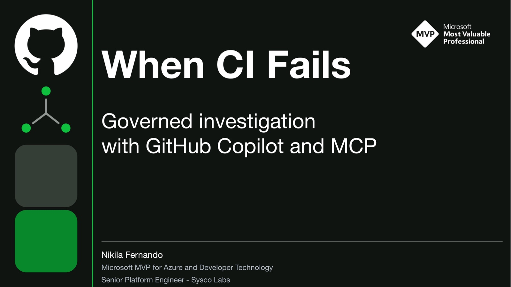
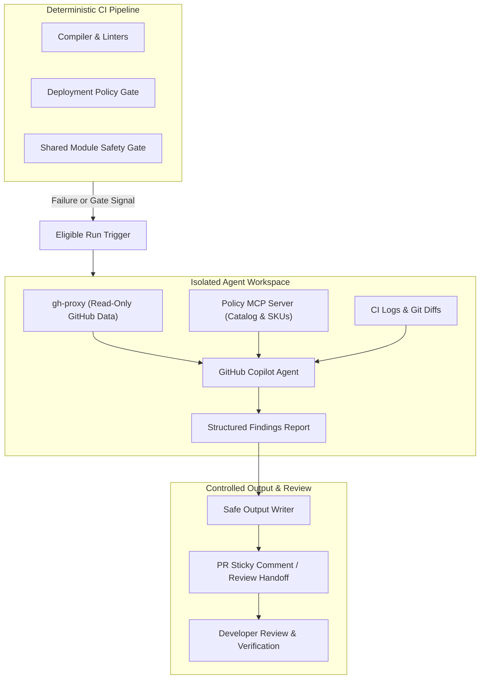
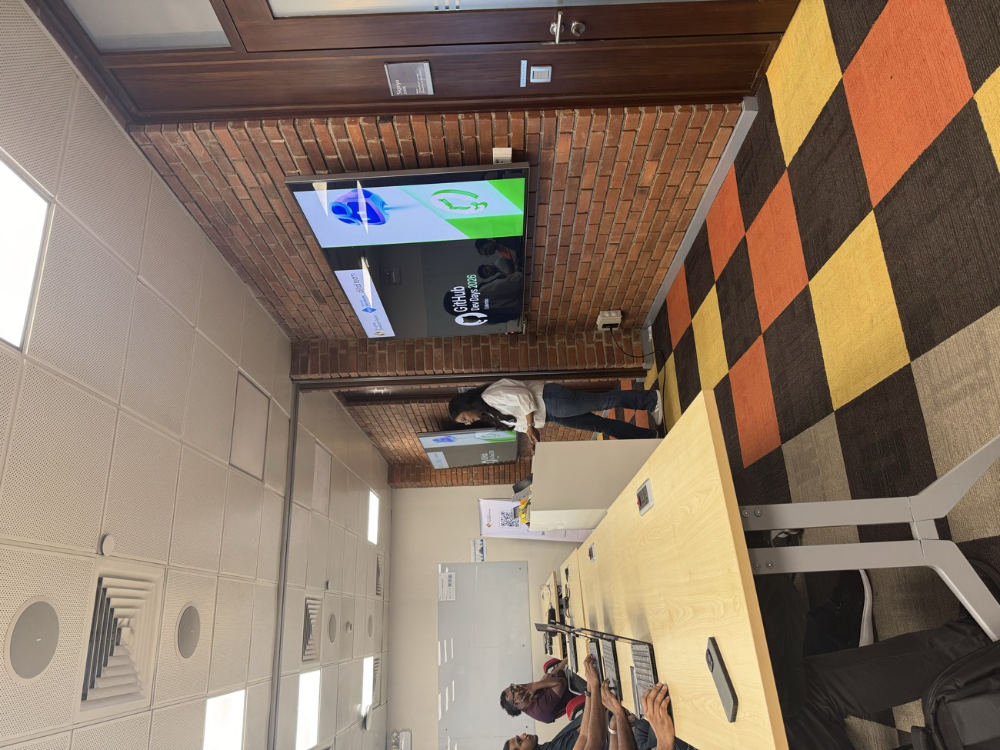
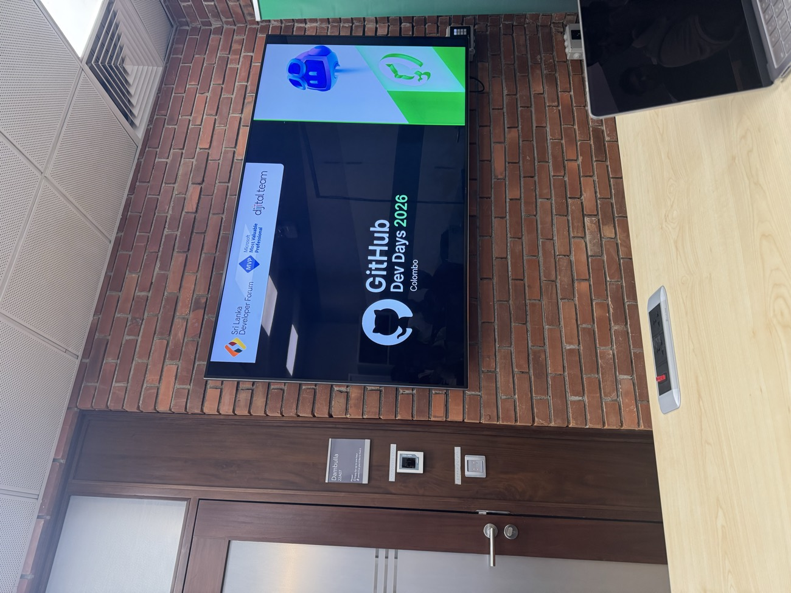
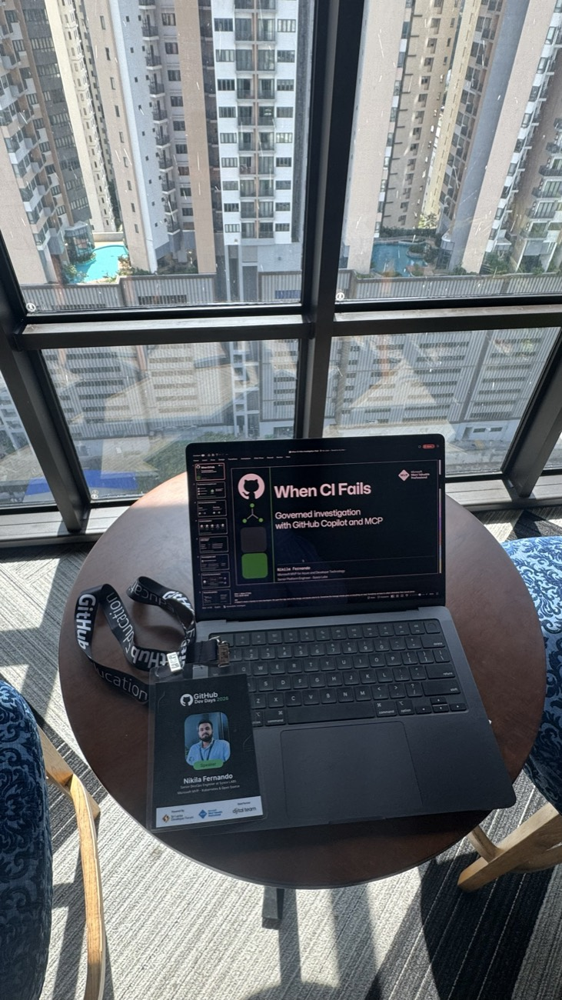
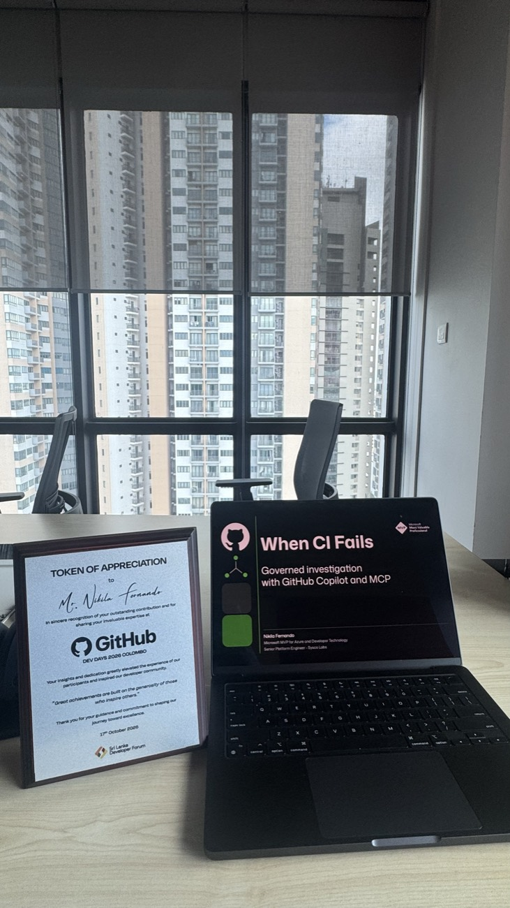

  

    

      
      
      
    

    ~/events/github-dev-days-2026
    SESSION RECAP
  

  

    
<strong>Event:</strong> GitHub Dev Days 2026

    
<strong>Date:</strong> 17 October 2026

    
<strong>Venue:</strong> Microsoft Sri Lanka Auditorium, Colombo

    
<strong>Host:</strong> Sri Lanka Developer Forum (SLDF)

    
<strong>Format:</strong> 35-min Presentation & Live Demos + Audience Q&amp;A

    
<strong>Deck:</strong> 22 Slides (PDF available below)

  

A failed CI check usually starts another round of investigation. Open the logs, check the diff, look through the repository, and work out what needs to change. Sometimes the answer is right there in the compiler output. Sometimes you need to understand a deployment policy, a shared module, or another application's configuration before the failure makes sense.

That was the starting point for my session, **When CI Fails: Governed Investigation with GitHub Copilot and MCP**, at **GitHub Dev Days 2026**, held on **17 October 2026 at Microsoft Sri Lanka**, organized by the **Sri Lanka Developer Forum (SLDF)**.

Across 35 minutes of content and live demonstrations, followed by questions, I explored how GitHub Agentic Workflows can bring that investigation into the development workflow and leave a useful engineering handoff on the pull request.

---

## Presentation Slide Deck

You can browse the complete 22-slide deck inline below, or download the PDF directly for offline reading:

  

    📄 Presentation Deck: When CI Fails (22 slides)
    

      <a href="./When-CI-Fails-Event-Slides.pdf" target="_blank" rel="noopener" style="font-size: 0.85rem; font-weight: 600; text-decoration: underline;">Open in new tab ↗</a>
      <a href="./When-CI-Fails-Event-Slides.pdf" download="When-CI-Fails-Event-Slides.pdf" style="font-size: 0.85rem; font-weight: 600; text-decoration: underline;">Download PDF ↓</a>
    

  

  <object
    data="./When-CI-Fails-Event-Slides.pdf"
    type="application/pdf"
    width="100%"
    height="580px"
    style="border: 1px solid var(--lightgray, #d8e0ea); border-radius: 8px; background: #ffffff; box-shadow: 0 4px 20px rgba(0,0,0,0.06);"
  >
    <iframe
      src="./When-CI-Fails-Event-Slides.pdf"
      width="100%"
      height="580px"
      style="border: none; border-radius: 8px;"
    >
      
Your browser does not support inline PDF viewing. <a href="./When-CI-Fails-Event-Slides.pdf">Download the slide deck</a> instead.

    </iframe>
  </object>

---

## The question behind the session

For me, the interesting question was how much useful context we could bring together around a CI result.

A developer might already have the error message. What they still need is an explanation that connects the error to the changed code, the relevant policy, and the correction they should review. In a shared platform, they may also need to understand which other applications are affected.

The workflow I demonstrated collected permitted evidence, retrieved selected organization context through Model Context Protocol (MCP), and produced findings with suggested corrections and verification steps.

> [!important] Keep merge decisions with required checks
> Deterministic checks enforce requirements. The investigation explains the evidence and proposes a next step for human review. Delivering a report cannot clear a failed safety gate or approve an exception.

---

## Demo one: one PR, two independent problems

The first example started with a familiar situation: **application tests passed, but other checks failed**.

A Bicep module's output declaration and the caller's reference no longer matched, so the real Bicep compiler rejected the build. Separately, a deployment policy check rejected public ingress for production.

These were two independent findings. Correcting the module reference would still leave the policy violation to address.

The investigation brought both into the report, connected each finding to its evidence, and suggested a separate correction for each one. This was the kind of handoff I wanted to explore: enough context for a developer to review the proposed changes and verify them.

---

## Demo two: passing checks, an affected consumer

The second example looked at a shared module default.

The root application supplied an explicit value, so changing the default did not break its normal checks. Another registered application inherited that default. For that consumer, the same change produced an effective configuration that violated its requirement.

Looking only at the root application's successful CI result would miss that difference.

A separate required **Shared Module Safety Gate** assessed the registered consumers and blocked the unsafe change. The investigation then explained which consumer was affected, how the inherited default caused the problem, and what needed review.

> [!note] What the demo established
> The examples used compiler and compiled-configuration evidence with two registered sample consumers. They did not deploy Azure resources or establish changes to existing deployed infrastructure.

---

## Architectural Flow

The diagram below illustrates the separation between deterministic gating, evidence gathering, bounded MCP context, and safe review publishing:

---

## How the pieces came together

I walked through the main parts of the implementation:

- **GitHub Agentic Workflows (`gh-aw`):** Markdown definitions described the events, tools, instructions, limits, and outputs. Compilation produced the executable `.lock.yml` workflows.
- **GitHub Copilot:** The investigation used the permitted tools and evidence to prepare an explanation and proposed next steps.
- **`gh-proxy`:** A mediated read path supplied permitted GitHub evidence, including CI runs, jobs, pull requests, and repository information.
- **Policy MCP:** A temporary Node service in the CI worker exposed selected policy, ownership, approved SKU, and change-window context from a versioned sample catalog.
- **Controlled publishing:** Separate output controls and a trusted publisher handled delivery back to GitHub, while required checks retained control of merging.

Execution also needed selection. An eligible completed CI run could start the appropriate follow-up path. For shared-module changes, scope and consumer evidence were checked before model use. An unchanged module or a passing assessment could avoid a new investigation; invalid evidence needed manual review.

---

## Keeping the investigation useful

We also covered evidence quality, cost, and the limits of the approach.

Logs, code, PR descriptions, artifacts, and tool responses remain untrusted inputs. Reports need to identify the run and revision they describe, and missing evidence needs to stay visible as an unknown. A successfully published explanation still needs review for factual correctness.

> [!tip] Practical operational limits
> Budgets, bounded evidence, and consolidated context retrieval help control investigation work. The practical adoption question is whether the result improves triage and correction enough to justify model usage, operating effort, and report-review time.

The demo used a small policy catalog and two registered consumers. Extending it across an organization would require an authorized consumer inventory, reliable version and configuration evidence, and clear ownership of the context being supplied. An organization-owned MCP service could provide that context, with authentication, authorization, and freshness handled as part of its implementation.

---

## Event Photos & Highlights

A few snapshots from the session at the Microsoft Sri Lanka auditorium, presenting to developers, platform engineers, and community members:

  

    

      
      
      
    

    ~/events/github-dev-days-2026/photos
    01 / 04
  

  

    

      

        
      

      

        
      

      

        
      

      

        
      

    

  

  📸 <em>Session Highlights:</em> Click viewport or use ← / → keys to browse photos.
  Microsoft Sri Lanka • 17 Oct 2026

---

## What I wanted people to take away

1. **Start with a useful investigation question.** Don't just regenerate scanner output in prose; synthesize the root cause, downstream impact, and immediate next steps.
2. **Give the agent the evidence it needs, but bound its reach.** Keep credentials scoped and tools read-only.
3. **Make uncertainty visible.** If a downstream consumer contract cannot be loaded, flag it as an unknown rather than hallucinating safety.
4. **Keep human review in the loop.** Deterministic gates decide whether code merges; agents provide decision support.

For platform teams, shared changes make this especially relevant. A passing application check tells us about the configuration that was tested. Consumer-aware assessment helps us understand the wider impact, and a selected investigation can turn those findings into an actionable explanation.

Thank you to everyone who joined the session at **GitHub Dev Days 2026 in Colombo**! It was great to share this work with the community and explore where governed investigation can fit into everyday engineering workflows.

---

## Related Posts

- [[devops/your-policy-checks-are-green|Your Policy Checks Are Green. Your Impact Is Still Unknown.]]
- [[devops/azure-container-apps-sandboxes|Your Agent Needs a Boundary: Azure Container Apps Sandboxes]]
- [[notes/arc-github-runners-platform-as-a-service|Building an Internal CI PaaS with Actions Runner Controller]]
